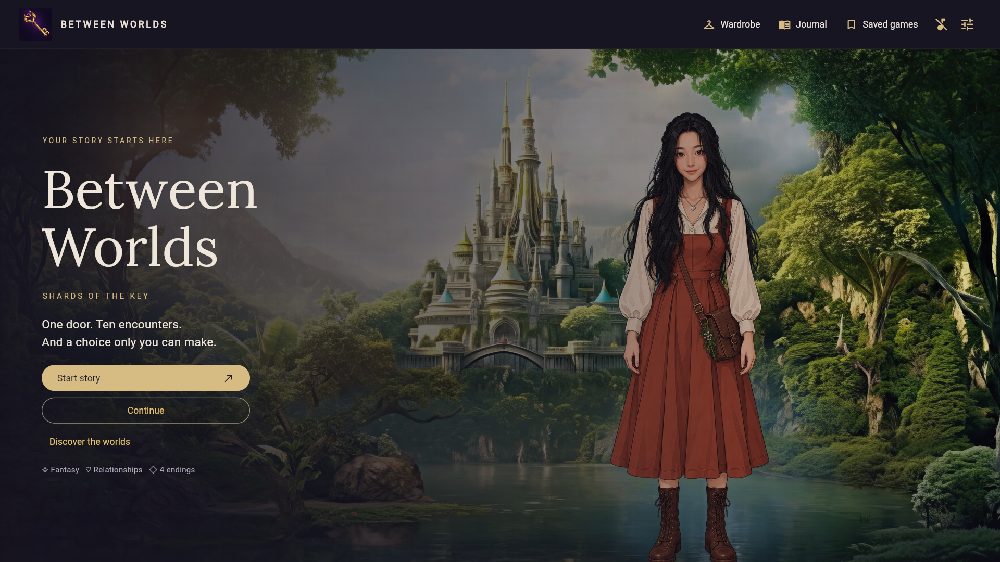
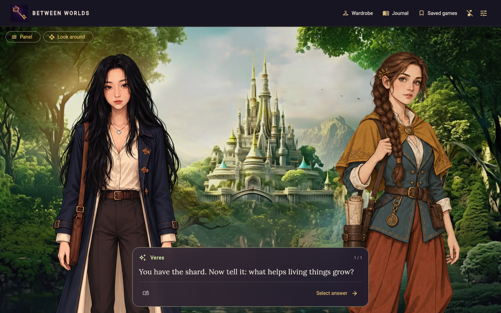
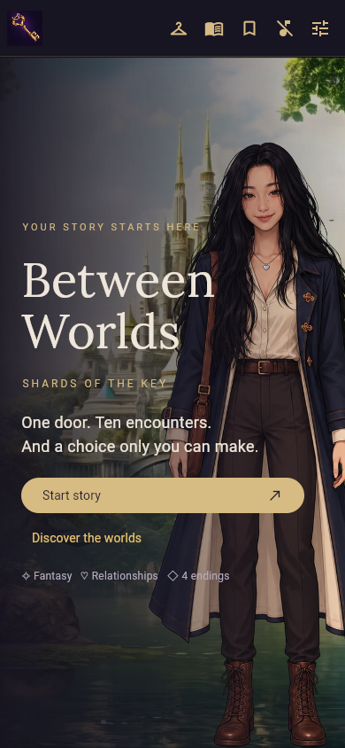
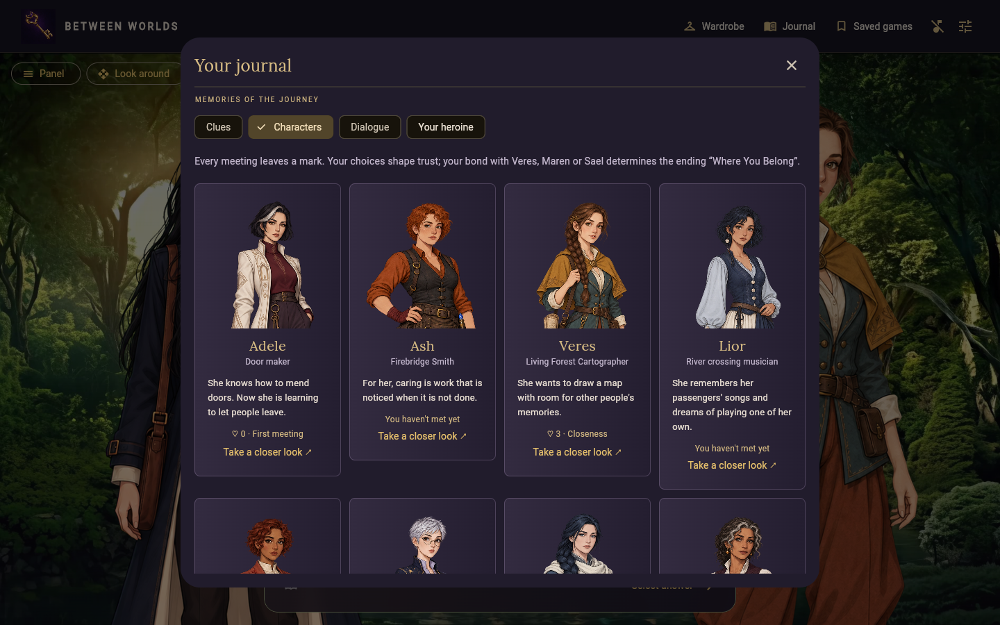

<div align="center">

# ✦ Between Worlds · Flutter Edition
### Shards of the Key, reimagined in Flutter
**One door. Ten encounters. Four endings.**

  

[Watch the video](https://youtu.be/Vh9yi6XxkY4) · [Screenshots](#-screenshots) · [Features](#-features) · [Get started](#-get-started) · [Browser edition](https://github.com/Arty1909/Between-Worlds)

</div>

[](https://youtu.be/Vh9yi6XxkY4)

**[▶ Watch the Between Worlds video on YouTube](https://youtu.be/Vh9yi6XxkY4)**

## ✧ About the game

*Between Worlds: Shards of the Key* is an offline interactive fantasy novel. Step through a mysterious door, meet the guardians of several worlds, collect the key's shards, and make choices that change relationships and the ending. This repository is the **Flutter adaptation** of the [browser edition](https://github.com/Arty1909/Between-Worlds), with a native interface for desktop and mobile screens.

## ✨ Features

| | |
| --- | --- |
| 🗝️ **Branching story** | A prologue, six chapters, ten guardians, dialogue challenges, a symbol puzzle, and four endings. |
| 📖 **Journal** | Browse clues, dialogue, character profiles, and relationship progress. |
| 👗 **Wardrobe** | Change the heroine's look and examine character portraits. |
| 🌍 **Living scenes** | Illustrated worlds, character animation, scene transitions, and a pan-and-zoom camera. |
| 🎵 **Sound and video** | World music, effects, and optional ambient motion powered by `media_kit`. |
| 💾 **Offline progress** | Local saves with recovery from a previous valid save; no account or hosted API. |
| 🌐 **Five languages** | English, Russian, Spanish, Italian, and French. |
| ⚙️ **Player settings** | Music, effects, animation, typewriter speed, text size, and language controls. |

## 📸 Screenshots

<table><tr><td width="65%"></td><td width="35%"></td></tr><tr><td align="center">Story scene</td><td align="center">Mobile layout</td></tr></table>

<details><summary><strong>📖 Open the character journal</strong></summary>



</details>

<details><summary><strong>🧭 What can happen in a playthrough?</strong></summary>

Your choices build trust and courage as you explore the worlds. The journal collects clues for later decisions. Dialogue trials and a lighthouse puzzle can unlock another path. At the end, the heroine may return home, stay and build a new life, join the worlds, or follow the unknown.

</details>

## ▶️ Get started

Install a current [Flutter SDK](https://docs.flutter.dev/get-started/install) with a compatible Dart SDK (**>=3.10.0 <4.0.0**), then run:

```bash
flutter pub get
flutter run -d windows
```

Use `flutter devices` to list available targets and replace `windows` with your device ID for Android, iOS, macOS, Linux, or web. Platform toolchains are required for their respective builds. All story data and media are packaged in `assets/`; gameplay does not call a backend service.

For a release build, use the standard Flutter command for your target, for example `flutter build apk` or `flutter build windows`. Build outputs and signing files are excluded from the repository.

## 🧩 Project map

| Path | Purpose |
| --- | --- |
| `lib/game/engine.dart` | Story state, actions, branching logic, and saved progress. |
| `lib/game/controller.dart` | UI state, settings, localization, media lookup, and persistence. |
| `lib/game/catalog.dart` | Five-language translation catalog and template handling. |
| `lib/ui/` | Home, story, journal, wardrobe, settings, and responsive widgets. |
| `assets/data/` | Story, scene, arrival, and media metadata. |
| `assets/` | Artwork, audio, video, localization, and fonts. |
| `test/` | Flutter widget, story, and localization checks. |
| `tool/` | Content and packaging utilities. |

Run the project tests with `flutter test`. The original [browser edition](https://github.com/Arty1909/Between-Worlds) has a separate JavaScript interface and local story server.

## ⚖️ License and media

The **source code** is available under the [MIT License](LICENSE). Artwork, screenshots, character portraits, music, video, and other game media are **not licensed under MIT**. See [Media rights](MEDIA_RIGHTS.md). The bundled Lora font is distributed under its own [Open Font License](assets/fonts/OFL.txt); other third-party components retain their own terms.
